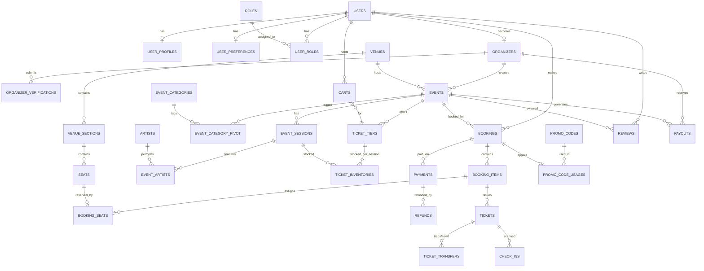
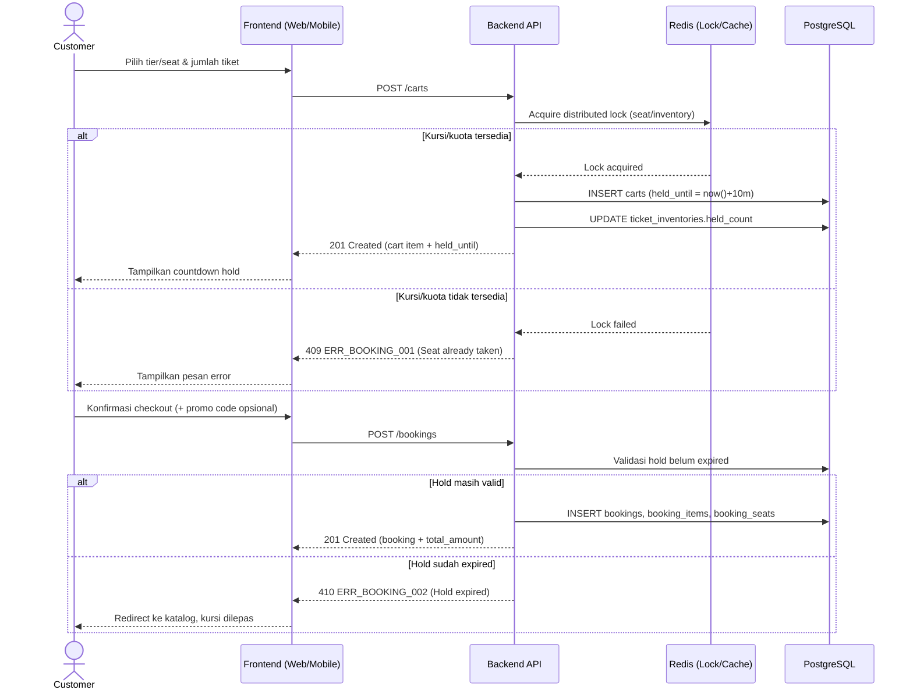
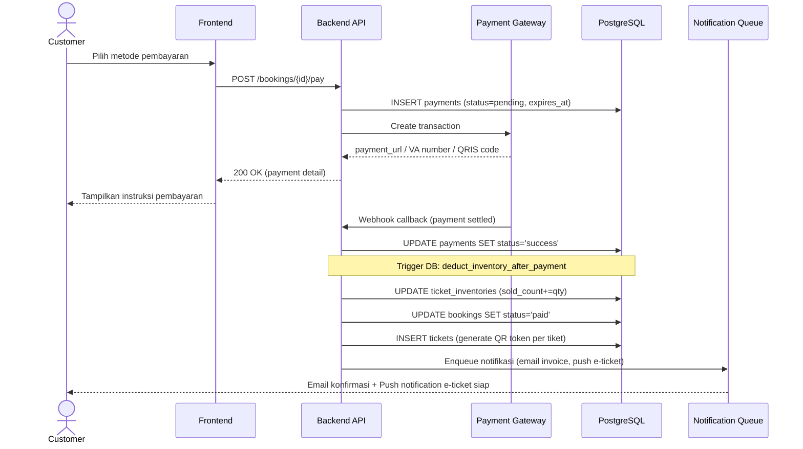
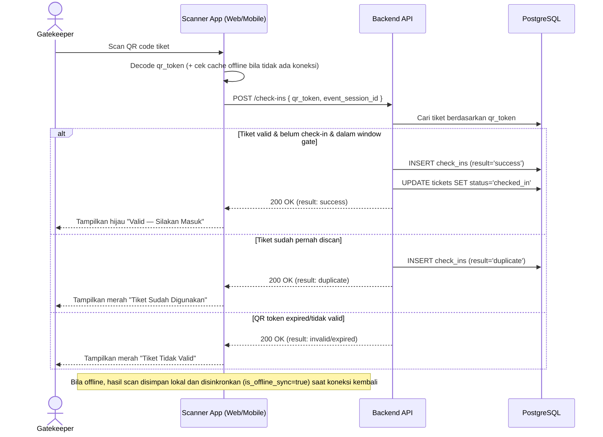

# Product Requirements Document (PRD)
# Konsera — Aplikasi Pemesanan Tiket Konser (Web & Mobile)

**Versi**: 1.0
**Status**: Draft untuk eksekusi Tim Frontend & Backend
**File terkait**: `database-schema.sql`, `openapi-spec.yaml`

---

## 1. Executive Summary

**Nama Produk**: Konsera

**Deskripsi**: Konsera adalah platform pemesanan tiket konser end-to-end yang menghubungkan penyelenggara acara (organizer) dengan pembeli tiket (customer). Platform mencakup pembuatan & moderasi event, seat map interaktif, checkout dengan penguncian inventori real-time, pembayaran multi-channel, e-ticket berbasis QR dinamis anti-fraud, serta modul check-in di venue.

**Target Pengguna**:
| Peran | Kebutuhan Utama |
|---|---|
| Penyelenggara konser (Organizer) | Membuat & mengelola event, venue, harga tiket, memantau penjualan, menerima payout |
| Pembeli tiket (Customer) | Menemukan event, membeli tiket dengan aman, mendapat e-ticket, check-in cepat |
| Admin platform | Moderasi event, verifikasi organizer, manajemen keuangan, dukungan dispute |
| Gatekeeper/Scanner | Validasi tiket di pintu masuk venue |

**Platform**:
- **Web**: Next.js 14 (App Router) + TypeScript
- **Mobile**: React Native (Expo) + TypeScript, dengan fallback PWA untuk web mobile

**Model bisnis**: Platform fee 5–10% dari harga tiket per transaksi (configurable), dibayarkan ke organizer H+3 setelah event selesai.

---

## 2. Tech Stack

### 2.1 Backend
| Komponen | Pilihan |
|---|---|
| Bahasa | Go (Golang) 1.22+ |
| Framework HTTP | Gin |
| Database utama | PostgreSQL 15+ |
| Cache & session | Redis |
| Payment gateway | Midtrans / Xendit / Stripe (abstraksi via provider interface) |
| Autentikasi | JWT (Access token 15 menit, Refresh token 7 hari, rotation) |
| Dokumentasi API | Swagger / OpenAPI 3.0 |
| Testing | testify (unit), httptest (integration) |
| Deployment | Docker, Kubernetes, GitHub Actions CI/CD |

### 2.2 Frontend
| Komponen | Pilihan |
|---|---|
| Web | Next.js 14 App Router, TypeScript, Tailwind CSS, Shadcn/ui |
| Mobile | React Native (Expo), TypeScript |
| State server | TanStack Query (React Query) |
| State client | Zustand |
| Maps | Google Maps API |
| Real-time | Socket.io / native WebSocket |
| QR Scanner | `html5-qrcode` (web), `react-qr-reader`/Expo Camera (mobile) |
| Form & validasi | React Hook Form + Zod |

---

## 3. Core Features & Modules

### A. User Management
- Registrasi & login (email, Google OAuth, Apple OAuth)
- Verifikasi email; KYC untuk organizer (upload dokumen legal)
- RBAC: `super_admin`, `admin_event`, `organizer`, `customer`, `gatekeeper`
- Profil & preferensi (genre favorit, channel notifikasi)
- Alamat pengiriman (tiket fisik opsional) & digital wallet reference

### B. Event Management (Organizer)
- CRUD event (nama, deskripsi, poster, banner, kategori)
- Manajemen venue (indoor/outdoor, seat map, kapasitas)
- Manajemen jadwal (multi-session, multi-hari)
- Ticket tier (Early Bird, Regular, VIP, VVIP, Group Package)
- Kuota & inventori per tier per sesi
- Manajemen artis/lineup per sesi
- Alur approval: `draft → pending_review → approved/rejected → published`
- Dashboard analitik: penjualan, revenue, prediksi kehadiran

### C. Ticketing & Booking
- Katalog & discovery dengan filter (kota, tanggal, genre, harga, rating)
- Seat selection interaktif dengan ketersediaan real-time
- Cart & checkout dengan hold 10–15 menit dan penanganan konkurensi
- Batas maksimal 6 tiket per transaksi
- Kode promo (persentase / nominal tetap, batas pemakaian)
- Integrasi pembayaran (virtual account, e-wallet, kartu kredit, paylater, QRIS)
- Invoice & kwitansi PDF
- E-ticket QR dinamis + watermark anti-screenshot
- Transfer tiket (terkunci H-1 sebelum event)
- Refund & pembatalan sesuai kebijakan event

### D. Notification
- Push notification (Firebase Cloud Messaging)
- Email (SendGrid/AWS SES): konfirmasi booking, reminder H-3 & H-1
- SMS (Twilio): OTP, reminder pembayaran
- In-app notification center
- Preferensi channel & frekuensi

### E. Check-in & Access Control
- QR scanner (web & mobile) untuk gatekeeper
- Mode offline dengan sinkronisasi otomatis saat online kembali
- Dashboard kehadiran real-time
- Deteksi fraud (duplikasi QR, indikasi screenshot)
- Log & audit trail masuk

### F. Review & Community
- Rating & review (hanya setelah event selesai, memerlukan bukti kehadiran)
- Upload foto oleh user
- Forum diskusi/Q&A per event
- Sistem pelaporan konten (spam, tidak pantas)

### G. Admin Dashboard
- Manajemen user (suspend, verifikasi organizer)
- Moderasi event (approve, reject, featured)
- Laporan keuangan (komisi, payout ke organizer)
- Resolusi dispute (refund, keluhan tiket)
- Konfigurasi sistem (struktur fee, mode maintenance)
- Audit log seluruh aktivitas kritis

---

## 4. Database Schema

ERD konseptual dan skrip migrasi SQL lengkap (35 tabel) tersedia pada file terpisah: **`database-schema.sql`**.

Ringkasan area data:
- **Identity**: `users`, `user_profiles`, `user_preferences`, `roles`, `user_roles`
- **Organizer**: `organizers`, `organizer_verifications`
- **Venue**: `venues`, `venue_sections`, `seats`
- **Event**: `events`, `event_categories`, `event_category_pivot`, `event_sessions`, `artists`, `event_artists`
- **Inventory**: `ticket_tiers`, `ticket_inventories`
- **Transaksi**: `carts`, `bookings`, `booking_items`, `booking_seats`, `payment_methods`, `payments`, `refunds`
- **Promo**: `promo_codes`, `promo_code_usages`
- **Tiket**: `tickets`, `ticket_transfers`, `check_ins`
- **Notifikasi**: `notification_templates`, `notifications`
- **Komunitas**: `reviews`, `favorites`
- **Finansial & Admin**: `commission_settings`, `payouts`, `audit_logs`

### 4.1 Entity Relationship Diagram (ringkas)



---

## 5. API Specification

Spesifikasi lengkap OpenAPI 3.0 (semua endpoint REST, request/response schema, error codes) tersedia pada file terpisah: **`openapi-spec.yaml`**.

### 5.1 Response Standard

Semua response API mengikuti format seragam:

```json
{
  "success": true,
  "message": "string",
  "data": {},
  "meta": { "page": 1, "limit": 10, "total": 100, "total_pages": 10 },
  "errors": null
}
```

### 5.2 WebSocket Events

Koneksi WebSocket diautentikasi menggunakan JWT pada handshake (`?token=<access_token>` atau header `Authorization`).

| Event | Arah | Deskripsi |
|---|---|---|
| `event:booking:hold` | Server → Client | Broadcast saat seat/inventory di-hold, untuk update seat map real-time |
| `event:booking:release` | Server → Client | Broadcast saat hold timeout dan seat dilepas |
| `event:ticket:sold` | Server → Organizer Dashboard | Notifikasi penjualan tiket baru |
| `notification:new` | Server → Client | Push notifikasi in-app real-time |
| `checkin:success` | Server → Organizer Dashboard | Broadcast saat check-in berhasil untuk update dashboard kehadiran |

### 5.3 Sequence Diagram — Booking Flow



### 5.4 Sequence Diagram — Payment Flow



### 5.5 Sequence Diagram — Check-in Flow



---

## 6. Frontend Architecture

### 6.1 Web (Next.js 14 — App Router)

```
src/
├── app/
│   ├── (auth)/            # login, register, forgot-password
│   ├── (main)/            # katalog, detail event, checkout, profil
│   ├── (organizer)/       # dashboard organizer
│   ├── (admin)/           # dashboard admin
│   ├── api/               # route handlers (proxy/BFF opsional)
│   └── layout.tsx
├── components/
│   ├── ui/                # Shadcn/ui primitives
│   ├── forms/
│   ├── layouts/
│   └── features/          # SeatMap, EventCard, CheckoutSummary, dll
├── hooks/
├── lib/                    # api client, utils, socket client
├── stores/                 # Zustand: auth, cart, ui
├── types/
└── styles/
```

### 6.2 Mobile (React Native / Expo)

```
src/
├── app/                    # Expo Router
├── components/
├── screens/
├── hooks/
├── services/                # api integration, qr scanner service
├── stores/
├── types/
└── utils/
```

### 6.3 Shared TypeScript Types

Interface wajib didefinisikan di package `@konsera/shared-types` agar konsisten Web & Mobile:
`User`, `Organizer`, `Venue`, `VenueSection`, `Seat`, `Event`, `EventSession`, `TicketTier`, `TicketInventory`, `Cart`, `Booking`, `BookingItem`, `Payment`, `Ticket`, `CheckIn`, `Notification`, `Review`, `Promo`, dan tipe WebSocket event payloads di atas. Skema validasi form menggunakan Zod, di-mirror dari tipe yang sama.

### 6.4 State Management Strategy

| Jenis state | Tools | Contoh |
|---|---|---|
| Server state | TanStack Query | Daftar event, detail booking, status pembayaran (polling/refetch) |
| Client state | Zustand | Auth session, isi cart lokal, UI (modal, filter aktif) |
| Form state | React Hook Form + Zod resolver | Form event, form checkout, form profil |

### 6.5 Key UI/UX Flows

1. **Discovery Flow**: Home → Search/Filter → Detail Event → Pilih Sesi → Pilih Tier/Kursi → Cart
2. **Checkout Flow**: Cart → Terapkan Promo → Pilih Pembayaran → Bayar → Konfirmasi → E-Ticket
3. **Organizer Flow**: Dashboard → Buat Event → Konfigurasi Venue & Kursi → Atur Harga → Publish → Pantau Penjualan
4. **Check-in Flow**: Buka Scanner → Scan QR → Validasi → Feedback Sukses/Gagal

---

## 7. Security Requirements

- **Autentikasi**: JWT dengan refresh token rotation, disimpan sebagai httpOnly cookie (web) / secure storage (mobile)
- **Otorisasi**: RBAC via middleware per route, dicek di setiap handler backend (tidak hanya di FE)
- **Proteksi data**: Enkripsi kolom PII sensitif (email, phone) at-rest; password di-hash dengan bcrypt (cost ≥ 12)
- **Keamanan pembayaran**: Kepatuhan PCI-DSS didelegasikan ke payment gateway; Konsera tidak pernah menyimpan data kartu kredit mentah
- **Rate limiting**: Redis-based, 100 req/menit untuk endpoint publik, 1000 req/menit untuk endpoint terautentikasi
- **CORS**: Whitelist domain resmi Konsera (web app, mobile deep link scheme)
- **Validasi input**: Skema Zod di FE, validasi ulang wajib di BE (jangan percaya validasi FE)
- **Anti SQL Injection**: Parameterized query via GORM/ent/SQLx, tidak ada raw string concatenation
- **Proteksi XSS**: Content Security Policy header, escape semua output yang berasal dari user-generated content

### 7.1 Pencegahan Fraud Tiket
- QR code memiliki masa berlaku singkat (5 menit) sebagai lapisan pertama
- QR bersifat dinamis, token berubah setiap 30 detik (mengurangi risiko screenshot lama beredar)
- Watermark berisi hash user ID + timestamp disematkan di tampilan e-ticket
- Validasi scan bersifat satu kali (one-time scan); percobaan kedua ditandai `duplicate`

---

## 8. Performance & Scalability

- **Database**: Connection pooling via PgBouncer; read replica untuk query berat (katalog, laporan)
- **Caching**: Redis untuk session, ketersediaan kursi real-time, katalog event (TTL 5 menit)
- **CDN**: CloudFront/Cloudflare untuk asset statis (poster, banner)
- **Optimasi gambar**: `next/image`, lazy loading, format WebP
- **Optimasi database**: Indexing strategis (lihat `database-schema.sql`), query plan review, pagination cursor-based untuk data besar (misal daftar tiket organizer besar)
- **Penanganan konkurensi**:
  - Optimistic locking pada `ticket_inventories.version` untuk mencegah overselling
  - Distributed lock (Redis Redlock) saat proses hold seat/inventori
  - Queue (misal RabbitMQ/SQS) untuk pemrosesan callback pembayaran agar tidak blocking request
- **Horizontal scaling**: Backend stateless, orkestrasi container (Kubernetes) dengan autoscaling berbasis CPU/RPS

---

## 9. Business Rules & Logic

### 9.1 Booking Rules
- Maksimal 6 tiket per transaksi
- Durasi hold: 10 menit (countdown ditampilkan di FE)
- Kursi/kuota otomatis dilepas jika tidak dibayar dalam waktu hold
- Refund tidak diperbolehkan < 7 hari sebelum event (kecuali force majeure, ditentukan admin)
- Tier Early Bird: kuota terbatas, otomatis ditutup saat habis atau melewati deadline

### 9.2 Payment Rules
- Masa berlaku pembayaran: 24 jam untuk virtual account, 15 menit untuk e-wallet
- Refund sebagian (partial refund) mengikuti kebijakan masing-masing event
- Platform fee: 5–10% dari harga tiket (configurable per global/organizer/event via `commission_settings`)
- Payout ke organizer: H+3 setelah event selesai

### 9.3 Check-in Rules
- Gerbang dibuka 2 jam sebelum event mulai
- Gerbang ditutup 1 jam setelah event mulai
- Multiple entry tidak diperbolehkan, kecuali tiket bertipe VIP pass (dikonfigurasi per tier)
- Tiket terkunci untuk transfer mulai H-1 sebelum event

---

## 10. Error Handling & Logging

### 10.1 Standar Kode Error

```json
{
  "ERR_AUTH_001": "Invalid credentials",
  "ERR_AUTH_002": "Token expired",
  "ERR_BOOKING_001": "Seat already taken",
  "ERR_BOOKING_002": "Hold expired",
  "ERR_PAYMENT_001": "Payment failed",
  "ERR_EVENT_001": "Event not found",
  "ERR_PERM_001": "Insufficient permission"
}
```

### 10.2 Logging
- Structured logging menggunakan Zap (Go)
- Level log: `DEBUG`, `INFO`, `WARN`, `ERROR`, `FATAL`
- Centralized logging: ELK Stack atau Grafana Loki
- Data sensitif (password, token, nomor kartu) di-mask sebelum ditulis ke log

---

## 11. Testing Strategy

### 11.1 Backend (Go)
- Unit test service layer dengan mock repository (`testify/mock`)
- Integration test endpoint API dengan test database terisolasi
- Load test: K6/Locust, simulasi 10.000 concurrent booking pada endpoint `POST /carts` dan `POST /bookings`
- Target coverage: > 80%

### 11.2 Frontend
- Unit test: Jest + React Testing Library
- E2E test: Playwright (Web), Detox (Mobile)
- Visual regression: Chromatic/Storybook untuk komponen UI kritis (SeatMap, CheckoutSummary)

---

## 12. Deployment & DevOps

### 12.1 Infrastruktur
- Cloud provider: AWS / GCP / DigitalOcean
- Container: Docker multi-stage build
- Orkestrasi: Kubernetes (EKS/GKE)
- Database: Managed PostgreSQL (RDS/Cloud SQL)
- Cache: Managed Redis (ElastiCache/Memorystore)
- CI/CD: GitHub Actions — Build → Test → Deploy Staging → Deploy Production

### 12.2 Environment
- Development, Staging, Production terpisah
- Manajemen environment variable via Vault/AWS Secrets Manager
- Migrasi database: `golang-migrate` atau Atlas

### 12.3 Monitoring
- APM: Datadog / New Relic / Grafana
- Uptime monitoring: UptimeRobot / Pingdom
- Alerting: PagerDuty / Opsgenie

---

## 13. Wireframe Description (Textual) — Key Screens

### 13.1 Home / Discovery (Web & Mobile)
- Header: logo, search bar, filter kota, ikon notifikasi, avatar user
- Section "Featured Events": carousel horizontal poster event unggulan
- Section "Rekomendasi untukmu": grid card event berdasarkan genre favorit di preferensi
- Filter panel (collapsible di mobile): kota, tanggal, genre, rentang harga, urutkan
- Card event: poster, judul, tanggal, venue, badge harga mulai dari

### 13.2 Event Detail
- Banner besar di atas, judul event, tanggal & venue dengan tombol "Lihat di Maps"
- Tab: Deskripsi | Lineup Artis | Ulasan | Q&A
- Sticky bottom bar (mobile) / sidebar (web): pilih sesi (dropdown jika multi-hari), tombol "Pilih Tiket"

### 13.3 Seat Selection / Tier Selection
- Jika event seated: kanvas seat map interaktif dengan legenda warna (tersedia/dipilih/terisi), zoom & pan
- Jika event non-seated: daftar tier sebagai card dengan stepper jumlah tiket dan indikator kuota tersisa
- Ringkasan pemesanan sticky di bawah/samping dengan total harga dan timer hold

### 13.4 Cart & Checkout
- Daftar item dengan qty editable, subtotal per item
- Input kode promo dengan validasi inline
- Ringkasan biaya: subtotal, diskon, biaya platform, total
- Pilihan metode pembayaran (grid ikon: VA bank, e-wallet, kartu kredit, QRIS, paylater)
- Countdown timer hold yang jelas terlihat di seluruh alur checkout

### 13.5 Payment & Confirmation
- Instruksi pembayaran spesifik metode (nomor VA / QR code / redirect kartu)
- Status polling otomatis (WebSocket/interval) dengan indikator loading
- Halaman konfirmasi sukses: ringkasan booking, tombol "Lihat E-Ticket", tombol unduh invoice PDF

### 13.6 E-Ticket
- Kartu tiket digital dengan QR code besar di tengah (dinamis, auto-refresh tiap 30 detik dengan indikator visual)
- Watermark halus nama pembeli + timestamp di background
- Info: nama event, sesi, tier, nomor kursi (jika ada), venue, tombol "Transfer Tiket" (disabled jika H-1)

### 13.7 Organizer Dashboard
- Sidebar navigasi: Event Saya, Buat Event Baru, Analitik, Payout, Pengaturan
- Halaman "Buat Event": wizard multi-step (Info Dasar → Venue & Seat Map → Sesi & Jadwal → Ticket Tier & Harga → Review & Submit)
- Halaman Analitik: grafik penjualan harian, breakdown per tier, peta panas kehadiran per sesi

### 13.8 Admin Dashboard
- Tabel event pending review dengan aksi cepat Approve/Reject + kolom alasan
- Tabel user dengan filter status, aksi suspend/verify
- Halaman Finansial: ringkasan komisi terkumpul, daftar payout terjadwal dan riwayat

### 13.9 Scanner App (Gatekeeper)
- Layar full-screen kamera dengan bingkai target scan
- Feedback besar berwarna (hijau/merah/kuning) beserta suara/getaran setelah scan
- Indikator status koneksi (online/offline) dan jumlah antrean sinkronisasi offline
- Ringkasan real-time: total check-in / total tiket terjual untuk sesi berjalan

---

## 14. Deliverables Checklist

- [x] Dokumen PRD lengkap (dokumen ini)
- [x] Diagram ERD (Mermaid) — Bagian 4.1
- [x] API Documentation (OpenAPI 3.0) — `openapi-spec.yaml`
- [x] Database Migration Script (SQL) — `database-schema.sql`
- [x] Sequence Diagram: Booking Flow, Payment Flow, Check-in Flow — Bagian 5.3–5.5
- [x] Wireframe description (textual) untuk key screens — Bagian 13
